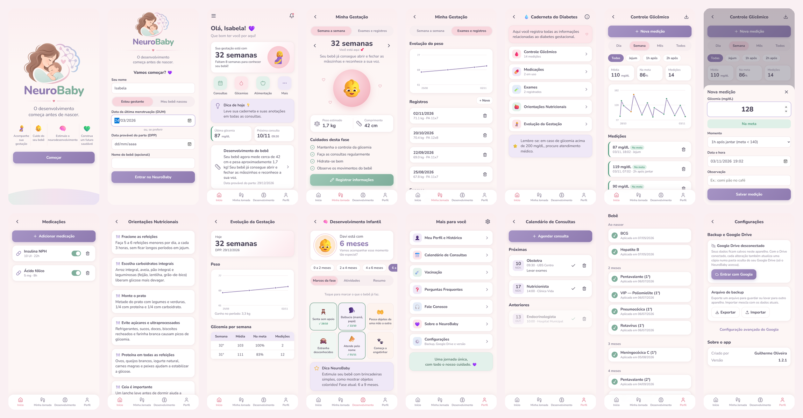
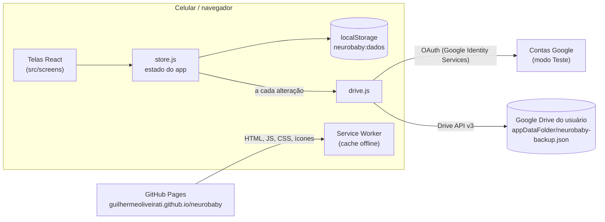
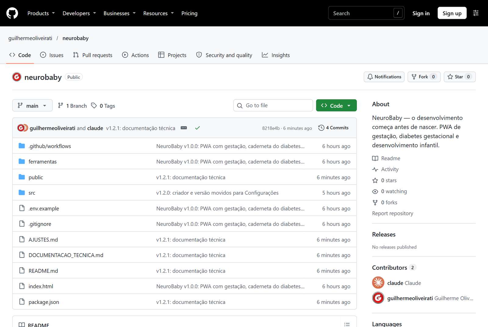
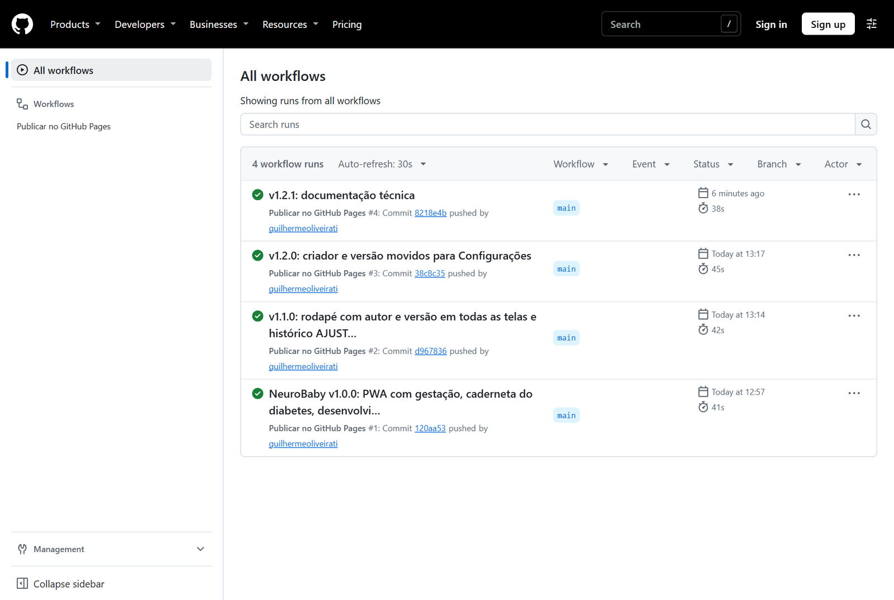
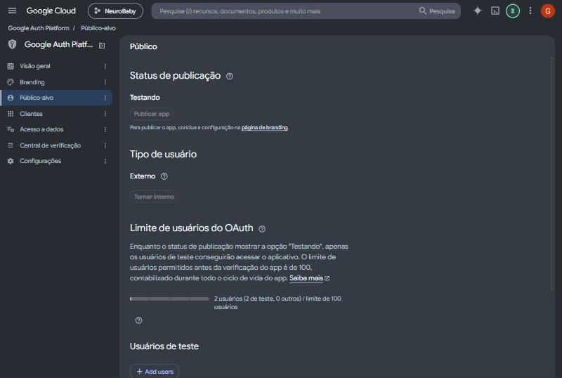
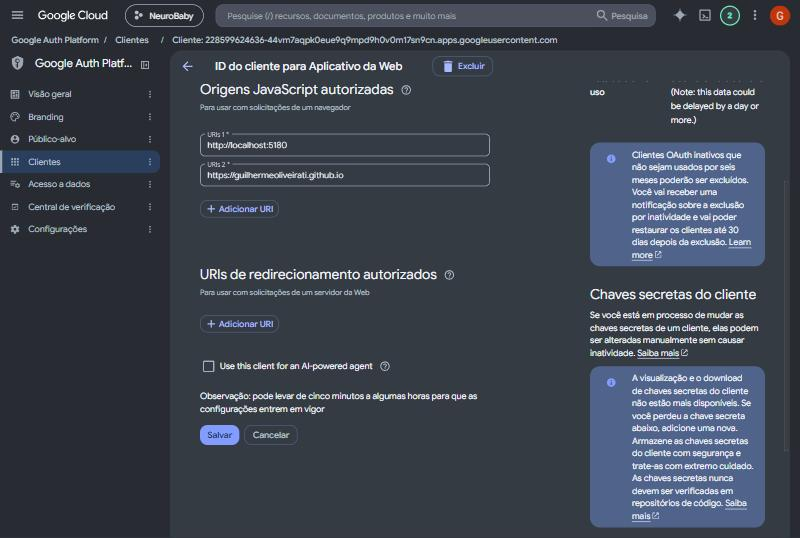

# NeuroBaby — Documentação técnica

Versão do app: **1.2.2** · Atualizado em 03/11/2026 · Criado por Guilherme Oliveira

O NeuroBaby é um **webapp PWA** (Progressive Web App) escrito em **JavaScript com React**, empacotado com **Vite**,
hospedado gratuitamente no **GitHub Pages** e com backup dos dados no **Google Drive** de cada usuário.
Não existe servidor nem banco de dados próprio: o app roda inteiro no navegador do aparelho.

| Item | Onde / o quê |
| --- | --- |
| Site publicado | https://guilhermeoliveirati.github.io/neurobaby/ |
| Código-fonte | https://github.com/guilhermeoliveirati/neurobaby (repositório público, branch `main`) |
| Pasta de trabalho | `J:\Meu Drive\NeuroBaby` (Google Drive do computador) |
| Login e backup | Google Cloud, conta `projetosguilherme7@gmail.com`, projeto `neurobaby` |
| Histórico de versões | [AJUSTES.md](AJUSTES.md) |
| Apresentação do sistema (com passo a passo) | https://claude.ai/artifact/R1ytK3RrX5dYiMxYeJwjjz |
| Documentação técnica com prints | https://claude.ai/artifact/WWkUoKNFRWJg9vKLHe9ogv |



---

## 1. Linguagens e tecnologias

| Camada | Tecnologia | Versão | Para que serve |
| --- | --- | --- | --- |
| Linguagem | JavaScript (ES2022, módulos ES) + JSX | — | Toda a lógica e as telas |
| Interface | [React](https://react.dev) | 18.3.1 | Componentes das telas e estado |
| Ícones | [lucide-react](https://lucide.dev) | 0.460.0 | Ícones de linha (menu, sino, gráficos…) |
| Estilo | CSS puro (`src/styles.css`) | — | Visual pastel, layout para celular (máx. 480 px) |
| Fonte | Nunito (Google Fonts) | — | Tipografia |
| Empacotador | [Vite](https://vitejs.dev) + `@vitejs/plugin-react` | 5.4.21 / 4.7.0 | Servidor de desenvolvimento e build de produção |
| Ambiente | Node.js | 22 | Rodar o Vite (local e no GitHub Actions) |
| Scripts | PowerShell (`ferramentas/neurobaby.ps1`) | 5.1 | Instalar dependências fora do Google Drive e rodar o Vite |
| PWA | Web App Manifest + Service Worker (`public/sw.js`) | — | Instalar na tela inicial e funcionar offline |
| Login Google | Google Identity Services (OAuth 2.0, token no navegador) | — | Autorizar o acesso ao Drive |
| Backup | Google Drive API v3 (pasta `appDataFolder`) | v3 | Guardar a cópia de segurança |
| Publicação | GitHub Actions + GitHub Pages | — | Build e hospedagem automáticos |

Não há TypeScript, biblioteca de gráficos nem roteador externo: os gráficos são SVG desenhados à mão
(`GraficoLinha` em `src/components/ui.jsx`) e a navegação usa o `#` da URL (ex.: `#/diabetes/glicemia`).

---

## 2. Arquitetura



- **Estado:** um único objeto (perfil, glicemias, medicações, exames, registros, consultas, vacinas, marcos, notas)
  em `src/data/store.js`, salvo no `localStorage` do navegador a cada alteração.
- **Backup:** `src/data/drive.js` envia o mesmo objeto como `neurobaby-backup.json` para a pasta oculta
  `appDataFolder` do Drive de quem está logado, 2,5 s depois de cada alteração, enquanto o token do Google for
  válido (~1 h). Sem token, marca "pendente" e o usuário sincroniza com um toque.
- **Offline:** o service worker guarda o app em cache. Páginas: rede primeiro, cache se offline.
  Demais arquivos: cache primeiro, atualizando em segundo plano.

---

## 3. Estrutura de pastas

```
NeuroBaby/
├── index.html                 Página base (manifest, ícones, fonte)
├── package.json               Nome, versão e dependências
├── AJUSTES.md                 Histórico de versões
├── DOCUMENTACAO_TECNICA.md    Este documento
├── README.md                  Como rodar e publicar
├── .env.example               Modelo do .env.local (Client ID do Google)
├── .github/workflows/pages.yml  Build e publicação no GitHub Pages
├── ferramentas/
│   ├── neurobaby.ps1          dev | build | preview (dependências fora do Drive)
│   └── vite.config.mjs        Configuração do Vite
├── public/                    Arquivos copiados como estão
│   ├── manifest.webmanifest   Dados do app instalável
│   ├── sw.js                  Service worker (offline)
│   ├── logo-ilustracao.png, logo-completo.png, favicon.png
│   └── icons/                 Ícones 192, 512 e Apple (180)
└── src/
    ├── main.jsx               Inicia o React e registra o service worker
    ├── App.jsx                Abertura, rotas e barra de navegação
    ├── styles.css             Todo o visual
    ├── utils.js               Cálculos (idade gestacional, idade do bebê, metas de glicemia, datas)
    ├── components/ui.jsx      Componentes comuns (topo, abas, listas, folha, gráfico, navegação)
    ├── data/
    │   ├── store.js           Estado + localStorage + mesclar backups
    │   ├── drive.js           Login Google e backup no Drive
    │   └── conteudo.js        Textos e tabelas (tamanho por semana, dicas, metas, marcos, vacinas, FAQ)
    └── screens/
        ├── Abertura.jsx       Splash, logo e cadastro/perfil
        ├── Inicio.jsx         Tela Início
        ├── Gestacao.jsx       Minha Gestação
        ├── Diabetes.jsx       Caderneta do Diabetes e subtelas
        ├── Desenvolvimento.jsx  Desenvolvimento Infantil
        └── Mais.jsx           Mais para você, Configurações e subtelas
```

### Rotas

| Endereço (`#/…`) | Tela |
| --- | --- |
| `inicio` | Início |
| `gestacao` | Minha Gestação |
| `diabetes` · `/glicemia` · `/medicacoes` · `/exames` · `/nutricao` · `/evolucao` | Caderneta do Diabetes e subtelas |
| `desenvolvimento` | Desenvolvimento Infantil |
| `mais` · `/perfil` · `/consultas` · `/vacinacao` · `/faq` · `/contato` · `/sobre` · `/backup` | Mais para você e subtelas (`/backup` = Configurações) |

---

## 4. Hospedagem e publicação

### GitHub Pages
- Repositório: `guilhermeoliveirati/neurobaby` (conta GitHub de `guilhermeoliveira.ti@gmail.com`).
- A cada `git push` na branch `main`, o workflow `.github/workflows/pages.yml`:
  1. instala Node 22 e as dependências numa pasta temporária;
  2. roda o build do Vite com o Client ID vindo da variável do repositório `GOOGLE_CLIENT_ID`;
  3. publica a pasta `dist/` no GitHub Pages (~1–2 min).
- O site é estático e público (qualquer pessoa com o link abre); os dados de saúde nunca passam pelo GitHub.





### Google Cloud (login e Drive)
- Conta dona: `projetosguilherme7@gmail.com` · Projeto: `neurobaby`.
- API ativada: **Google Drive API**.
- Tela de consentimento: público **Externo**, status **Testando**. Usuários de teste (os únicos que conseguem entrar):
  `guilhermeoliveira.ti@gmail.com` e `isabelacoorporativo@gmail.com`. Para liberar outra pessoa, adicione o e-mail em
  Google Auth Platform → Público → Usuários de teste.
- Cliente OAuth **NeuroBaby Web** (Aplicativo da Web), Client ID
  `228599624636-44vm7aqpk0eue9q9mpd9h0v0m17sn9cn.apps.googleusercontent.com`.
  Origens JavaScript autorizadas: `https://guilhermeoliveirati.github.io` e `http://localhost:5180`.
- Escopo pedido: `https://www.googleapis.com/auth/drive.appdata` — o app só enxerga a própria pasta oculta; não lê
  nem altera os demais arquivos do Drive. O segredo do cliente não é usado.





---

## 5. Desenvolvimento local

O Google Drive (J:) não suporta a pasta `node_modules`, então **nunca rode `npm install` na pasta do projeto**.
O script instala as dependências em `%LOCALAPPDATA%\NeuroBaby-deps` e roda o Vite apontando para o código no Drive.

```powershell
.\ferramentas\neurobaby.ps1 dev      # http://localhost:5180 (também acessível na rede local)
.\ferramentas\neurobaby.ps1 build    # gera dist/
.\ferramentas\neurobaby.ps1 preview  # testa o build
```

- Client ID local: arquivo `.env.local` (fora do git) com `VITE_GOOGLE_CLIENT_ID=...`.
- Git: a pasta `.git` real fica em `%LOCALAPPDATA%\NeuroBaby-git` (o projeto tem só um arquivo `.git` apontando para lá).
- Nova dependência: adicionar em `package.json` **e** um alias em `ferramentas/vite.config.mjs`.

### Publicar uma alteração
1. Subir a versão em `package.json` e o nome do cache em `public/sw.js`.
2. Registrar o ajuste no topo de [AJUSTES.md](AJUSTES.md).
3. `git add -A`, `git commit`, `git push` → o GitHub Pages atualiza sozinho.

---

## 6. Dados e privacidade

| Onde | O que fica | Quem acessa |
| --- | --- | --- |
| Aparelho (`localStorage`, chave `neurobaby:dados`) | Todos os registros | Só quem usa o aparelho |
| Google Drive do usuário (`appDataFolder/neurobaby-backup.json`) | Cópia de segurança | Só o NeuroBaby, na conta da própria pessoa |
| Arquivo exportado (`.json` / `.csv`) | Backup manual / glicemias | Quem tiver o arquivo |
| GitHub | Apenas o código do app | Público |

Cada conta Google tem o próprio backup; os dados não são compartilhados entre usuários.
